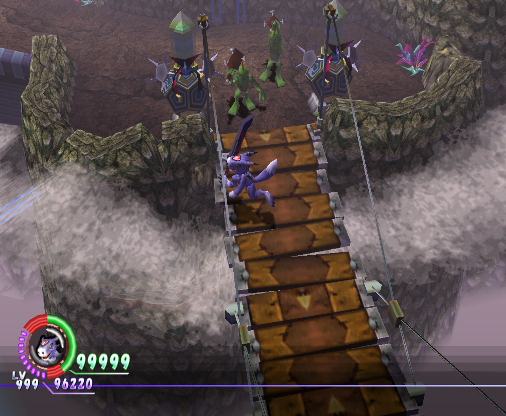
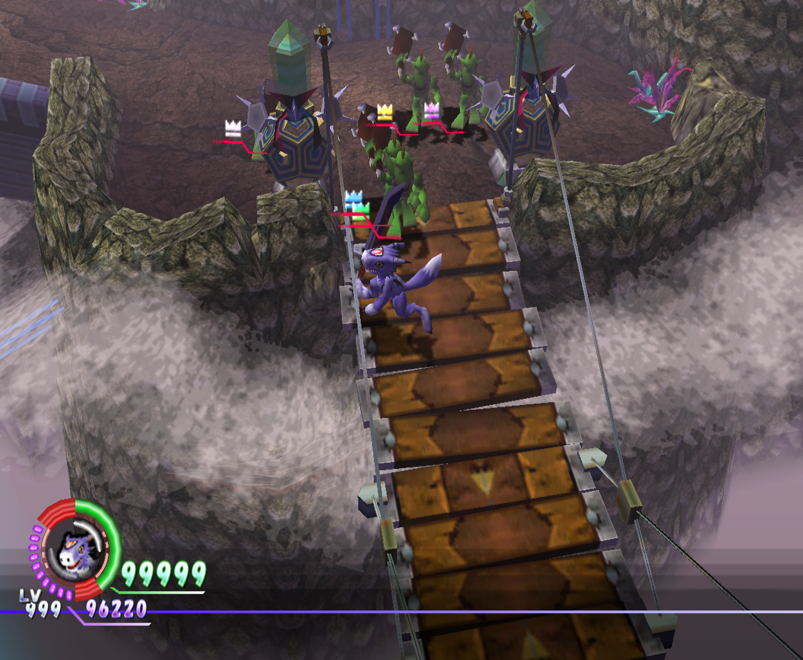

# Digimon World 4 Crown Mod & Enemy Randomiser

DW4 Crown Mod is a mod patcher and seeded enemy randomiser for **Digimon World 4**
on **PlayStation 2 (PS2)** and **GameCube**, available for **Windows and Linux**,
with a terminal version for **Windows 7**.

| Original game | Crown Mod — four-player spawns and random crown colours |
| --- | --- |
|  |  |

Open the app and choose your own copy of the game to create a new, modded copy.

## Quick start

1. [Download the app](#download) for Windows or Linux. On Windows 7, use the [terminal version](#windows-7).
2. Open it and choose your game disc image (`.iso`, or `.ciso` / `.rvz` for GameCube).
3. Select at least one option in Settings (grouped into Gameplay, Balance, Cosmetics and Bugfixes tabs). Choose **Random enemies** alone for the original balance, or enable **Crown Mod** for stronger enemies and increased rewards. Under Random enemies, optionally enable **Random bosses** on any supported PS2 or GameCube disc; every boss except the four world bosses is shuffled.
4. Click **Patch ISO**.
5. Play the new patched file in your emulator. A `.ciso` or `.rvz` stays in the same format.

Patching a clean disc leaves your original file unchanged.

## Share settings

Use **Export settings…** in the Settings panel to save your options and enemy
seed as a JSON file. **Import settings…** restores them without selecting a disc
or restoring file paths. You can import or export before choosing a disc.
Invalid or unsupported settings files leave your current options unchanged.
The same randomiser seed reproduces enemy choices within the same rules version.

## What the mod does

- **Optional Crown Mod.** Boost enemy health, combat stats and EXP, with crowns for every enemy. Its EXP popups display up to 99,999.

- **Optional random enemies.** Normal, Hard and Very Hard get separate seeded rosters. Aim for four distinct replacement families per stage and difficulty, spreading ordinary groups across compatible replacements and keeping native encounters where required. Load only the current difficulty's resources. River banks and train-side encounters use ranged families; enemies boarding the train stay native. Preserve each original spawn’s combat stats and EXP, with elemental resistance differences limited to ±100 points. Works with the original balance or Crown Mod.

- **Optional random bosses.** Enable this under Random enemies on any supported PS2 or GameCube disc. Shuffle dungeon bosses, overworld rematches and quest bosses while keeping the four world bosses fixed, preserving encounter frequencies, key drops and progression. Replacements avoid boss families already in patrols on any floor of the dungeon or quest, and dungeon intro text follows the selected boss.

- **Optional random crown colours.** Every enemy and boss gets a cosmetic crown
  in a random colour. Works with or without Crown Mod. This changes the icon only; combat stats and drops
  are unchanged. See [scope and validation](docs/testing/random-crowns.md).

- **Crown Mod sub-option: custom crown drops.** Rebalance eligible enemy loot toward equipment,
  x-data and plugs while retaining area/difficulty item pools. Existing guaranteed
  and quest rewards stay intact. See [rates and exceptions](docs/testing/custom-drops.md).

- **Optional four-player enemy spawns.** Use four-player spawn counts and wave
  limits with a smaller party. Enemy stats and per-kill drop tables are unchanged
  by this option. Stage scripts still use the actual party size.

- **Optional solo co-op buttons.** In single player, a pressed button of a
  two-player pair (floor buttons that release when you step off, and timed wall
  switches) stays down until you press its partner. Rooms whose number of
  buttons already scales with the party size are unchanged.

- **Bug fix: death softlock (on by default).** Dying before the first-death
  tutorial has played, for example after entering Goblin Fortress early, froze
  the game in vanilla. Stages that cannot show the tutorial now use the normal
  game-over and return you to the Main Lobby.
- **Bug fix: Blunt weapon skill text (on by default).** Dbl Axe, Rage Hammer,
  Hekatoncheir, Fang Smasher and Meteor Force are Blunt weapons, but their English
  descriptions said "Bash Skill". They now say "Blunt Skill". Only the description
  text changes.
- **Crown Mod balance.** Enemy health and other stats are boosted when Crown Mod is selected. Attack values are
  already near the game's maximum, so most of the extra difficulty comes from health
  and the other stat boosts.

## What you need

- A clean copy of Digimon World 4, as an `.iso` file (PS2 or GameCube), or a GameCube `.ciso` or `.rvz`. These releases work:

  | Release | Game ID |
  | --- | --- |
  | USA | `SLUS_208.36` |
  | Europe (English, German, Spanish, Italian) | `SLES_534.05` |
  | Japan (*Digimon World X*) | `SLPS_254.53` |
  | GameCube USA | `GDJE` |
  | GameCube Japan (*Digimon World X*) | `GDJJ` |

  GameCube images can be a plain `.iso`, an NKit `.iso`, a `.ciso` or an `.rvz` (uncompressed or zstd).

  The app detects your release automatically. Existing Crown Mod images can be
  updated; unsupported or unrecognised images are refused.
- Windows 10 or later, or Linux, for the app; 64-bit Windows 7 SP1 or later for the
  [terminal version](#windows-7). Nothing else to install.
- About **2.2 GB** of free disk space for the new file (more for `.ciso` and `.rvz`, which are unpacked while patching). The app shows the exact amount.

## Download

Get the latest version from the **Releases** page of this project:

- **Windows:** `.msi` installer or a plain `.zip`
- **Windows 7:** `-windows7-x86_64.zip`, the [terminal version](#windows-7)
- **Linux:** `.AppImage`, `.deb`, or a plain download

The downloads are unsigned, so Windows may show a warning the first time you run it.

### Windows 7

The desktop app needs Windows 10 or later. The Windows 7 download is the same
patcher in a console window, with every option and the same settings files.

1. Unzip it, then double-click `dw4-crown-mod-tui.exe`, or drag your disc image onto it.
2. Type or paste the path to your disc image and press **Enter**. You can also drag
   the file onto the window, or right-click in it and choose **Paste**.
3. Move with the arrow keys, turn options on or off with **Space**, and press
   **Enter** to continue. **L** and **S** load and save a settings file.
4. Check the output name and press **Enter** to patch.

The terminal version patches clean discs only. To update an existing Crown Mod
image, patch your original disc again.

## Updating the app

The app checks for newer versions at startup and shows their release notes before
asking whether to update. You can also use **Check for updates**.

On Windows, MSI installations automatically download and start the update
installer after you accept. Portable Windows builds open the GitHub release page.

On Linux, update through your package manager or manually download the latest
release. The **Update** button opens the GitHub release page.

Choose **Later** to keep using the current version.

## Updating your modded game

Open your existing Crown Mod image in the app. Its console, region and mod
version appear under Disc. Choose which optional features to keep, add or remove,
then click **Update ISO** and confirm. The app verifies the rebuilt game
before replacing the selected modded file.

Only images created with Crown Mod v0.11.1 or later can be updated. For an older
image, patch a clean, original disc image instead.

## Roadmap

- [ ] **Xbox support** — bring Crown Mod to the original Xbox release.
- [ ] **Tougher enemy AI** — make enemies more challenging through their behaviour.

## Contributing and building from source

Start with [CONTRIBUTING](CONTRIBUTING.md), the [architecture map](docs/ARCHITECTURE.md)
and the [development guide](docs/DEVELOPMENT.md). Release notes are in the [changelog](CHANGELOG.md).

No disc images or extracted game files are committed, and the app reads everything
it needs from your own disc.

## Licence

GPL-3.0-or-later. See `LICENSE`.
