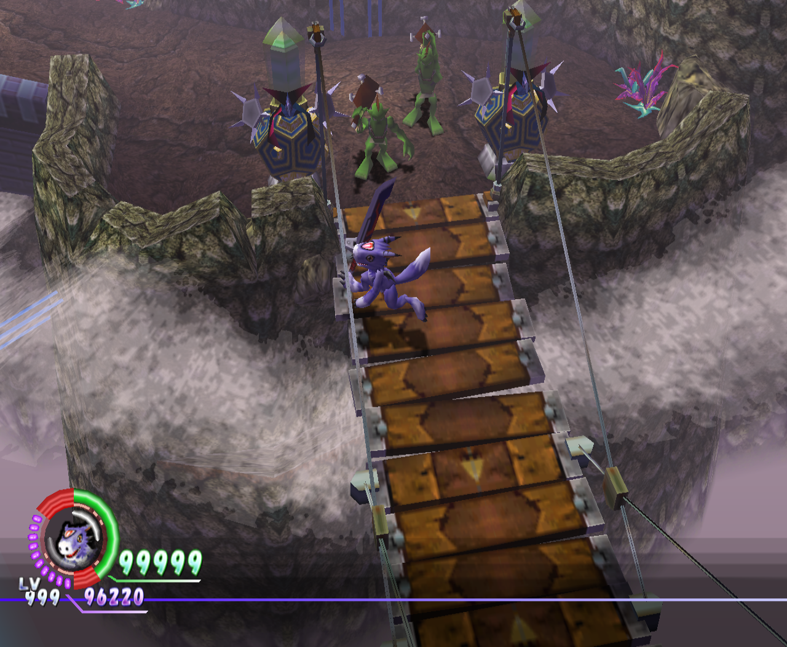
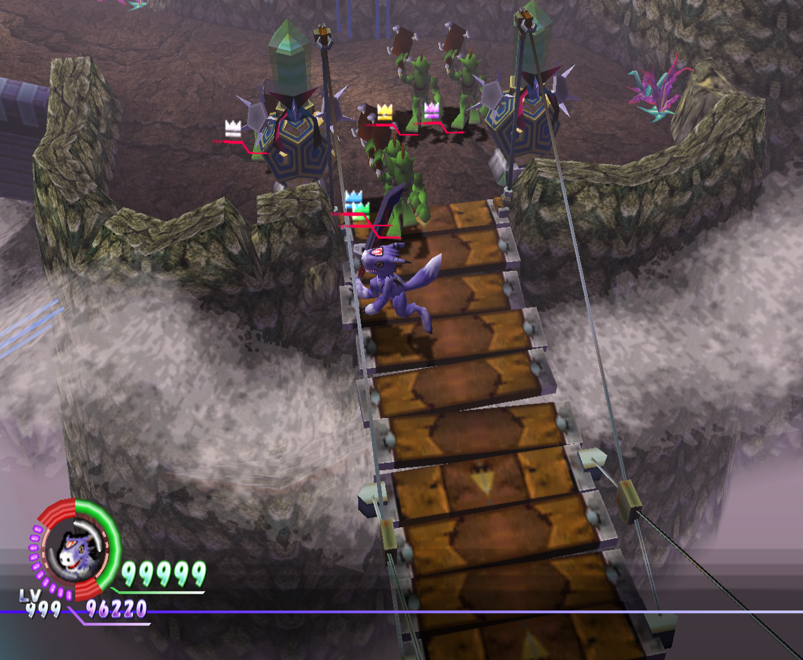

# DW4 Crown Mod

| Original game | Crown Mod — four-player spawns and random crown colours |
| --- | --- |
|  |  |

Patch **Digimon World 4** on PS2 and GameCube with optional Crown Mod difficulty,
random enemies and cosmetic crowns.

Open the app and choose your own copy of the game to create a new, modded copy.

## Quick start

1. [Download the app](#download) for Windows or Linux.
2. Open it and choose your game disc image (`.iso`, or `.ciso` / `.rvz` for GameCube).
3. Select at least one option in Settings. Choose **Random enemies** alone for the original balance, or enable **Crown Mod** for stronger enemies and increased rewards.
4. Click **Patch ISO**.
5. Play the new patched file in your emulator. A `.ciso` or `.rvz` stays in the same format.

Patching a clean disc leaves your original file unchanged.

## What the mod does

- **Optional Crown Mod.** Boost enemy health, combat stats and EXP, with crowns for every enemy. Its EXP popups display up to 99,999.

- **Optional random enemies.** Randomize ordinary encounters while preserving each original spawn’s combat stats and EXP, with elemental resistance differences limited to ±100 points. Works with the original balance or Crown Mod.

- **Optional random crown colours.** Every enemy and boss gets a cosmetic crown
  in a random colour. Works with or without Crown Mod. This changes the icon only; combat stats and drops
  are unchanged. See [scope and validation](docs/testing/random-crowns.md).

- **Crown Mod sub-option: custom crown drops.** Rebalance eligible enemy loot toward equipment,
  x-data and plugs while retaining area/difficulty item pools. Existing guaranteed
  and quest rewards stay intact. See [rates and exceptions](docs/testing/custom-drops.md).

- **Optional four-player enemy spawns.** Use four-player spawn counts and wave
  limits with a smaller party. Enemy stats and per-kill drop tables are unchanged
  by this option. Stage scripts still use the actual party size.
- **Crown Mod balance.** Enemy health and other stats are boosted when Crown Mod is selected. Attack values are
  already near the game's maximum, so most of the extra difficulty comes from health
  and the other stat boosts.

## What you need

- A clean copy of Digimon World 4, as an `.iso` file (PS2 or GameCube), or a GameCube `.ciso` or `.rvz`. These releases work:

  | Release | Game ID |
  | --- | --- |
  | USA | `SLUS_208.36` |
  | Europe (English, German, Spanish, Italian) | `SLES_534.05` |
  | Japan (*Digimon World X*) | `SLPS_254.53` |
  | GameCube USA | `GDJE` |
  | GameCube Japan (*Digimon World X*) | `GDJJ` |

  GameCube images can be a plain `.iso`, an NKit `.iso`, a `.ciso` or an `.rvz` (uncompressed or zstd).

  The app detects your release automatically. Existing Crown Mod images can be
  updated; unsupported or unrecognised images are refused.
- Windows or Linux. Nothing else to install.
- About **2.2 GB** of free disk space for the new file (more for `.ciso` and `.rvz`, which are unpacked while patching). The app shows the exact amount.

## Download

Get the latest version from the **Releases** page of this project:

- **Windows:** `.msi` installer or a plain `.zip`
- **Linux:** `.AppImage`, `.deb`, or a plain download

The downloads are unsigned, so Windows may show a warning the first time you run it.

## Updating the app

The app checks for newer versions at startup and shows their release notes before
asking whether to update. You can also use **Check for updates**.

On Windows, MSI installations automatically download and start the update
installer after you accept. Portable Windows builds open the GitHub release page.

On Linux, update through your package manager or manually download the latest
release. The **Update** button opens the GitHub release page.

Choose **Later** to keep using the current version.

## Updating your modded game

Open your existing Crown Mod image in the app. Its console, region and mod
version appear under Disc. Choose which optional features to keep, add or remove,
then click **Update ISO** and confirm. The app verifies the rebuilt game
before replacing the selected modded file.

Images created before Crown Mod v0.11.1 need the matching original disc for their
first update. After that, the updated image includes everything needed for future
updates.

## Roadmap

- [ ] **Xbox support** — bring Crown Mod to the original Xbox release.
- [ ] **Tougher enemy AI** — make enemies more challenging through their behaviour.

## Contributing and building from source

Start with [CONTRIBUTING](CONTRIBUTING.md), the [architecture map](docs/ARCHITECTURE.md)
and the [development guide](docs/DEVELOPMENT.md). Release notes are in the [changelog](CHANGELOG.md).

No disc images or extracted game files are committed, and the app reads everything
it needs from your own disc.

## Licence

GPL-3.0-or-later. See `LICENSE`.
